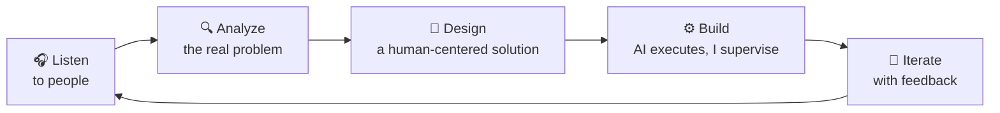

  

---

## 👋 Hi, I'm Sepehr

I'm a **software engineer who builds AI-powered products end to end**: from the backend (Go, Python, NestJS) to the interface (React, Next.js), and from the first conversation with the people who have the problem to the system running in production.

What drives me is **problem solving, not just writing functions.** I'm curious about *why* a team is stuck or *where* a business loses time and money, and I enjoy analyzing that, then designing a solution that fits the people who will use it, with technology as the tool and a human-centered approach as the compass.

> 💬 *"Code is Art, Code is Poetry."*
> The banner is my take on Michelangelo's *Creation of Adam*: the human spark reaching toward the machine. AI amplifies human craft; it doesn't replace it.

**Open to roles:** Forward Deployed Engineer · AI Applied Engineer · AI Software Engineer · AI Fullstack Engineer · Fullstack Engineer · Software Engineer

---

## 🗣️ Straight Talk

> **I haven't hand-written code in a year, and I'm not going back.**

For the past year my work has been **architecture and R&D**. I design the systems, make the technical decisions, evaluate and prototype technologies, and **AI executes the implementation under my strict supervision**, with every result reviewed and owned by me.

- 🧠 **What I own:** the problem analysis, architecture, trade-offs, technology choices and quality bar
- 🤖 **What AI does:** the typing, under my direction and review
- 🎯 **What you get:** problems turned into well-architected, working systems, fast

**If you want someone who still writes code by hand, I'm not your person.**
If you want an engineer who uses AI as a real force multiplier without giving up engineering rigor, let's talk.

---

## 🎯 What I Build

| | |
|---|---|
| 🤖 **AI-Powered Applications** | LLM apps, RAG pipelines, AI agents and workflow automation (n8n) that solve a concrete business problem |
| 🧩 **Fullstack Products** | React / Next.js frontends with NestJS, Go and Python backends and APIs |
| 🏢 **Enterprise Systems** | Deploying, customizing and integrating ERP and work-management platforms (Odoo, ERPNext/Frappe, Jira, Confluence) |
| 🧠 **Knowledge & Work Management** | Turning scattered knowledge and messy processes into systems that teams actually use |

---

## 🧭 How I Work

- **Problem first, technology second.** I pick the tool after I understand the pain.
- **Human-centered.** A system nobody adopts is a failed system, so I design for the people in the loop.
- **Close to the user.** I like working directly with users and stakeholders to understand their context.
- **Simple and maintainable.** Readable code, clear documentation, easy hand-over.

---

## 🌐 I'm Not Limited to a Language

The formula is fixed:

> **You have a problem. We both like a technology. We work on it together.**

Programming logic and algorithms don't change from one language to another. Syntax is the easy part. The stack below is what I've used so far, **not the boundary of what I can work with**. If the problem calls for something else, I'll use it.

---

## 🛠️ Tech Stack

### Languages & Frameworks

### AI & Automation

### Infrastructure & Tooling

### Operating Systems

### Enterprise Platforms

---

## 🤖 My AI Toolkit

AI agents do my implementation and help me learn. They multiply my output, while judgment and responsibility stay with me.

| Rank | Tool | Why |
|:---:|---|---|
| 🥇 | **Claude** | My #1, for everything |
| 🥈 | **Gemini** | My go-to for learning |
| ✦ | **Qwen** | Also in my rotation |
| ✦ | **Muse** | Also in my rotation |

---

## 📐 Ways of Working

---

## 🚀 Experience at a Glance

- 🏢 **Founder, Baloot** (دایان داده پرداز بلوط): digital transformation and enterprise software consultancy
- 🧱 **5+ years** developing and deploying enterprise software
- 🔧 **3+ years** of specialized Atlassian services: deployment, training, customization and support
- 🤝 Worked with **50+ organizations**, with recommendation letters from reputable companies

---

## 📊 GitHub Stats

---

## 🌱 Currently

- 🔭 Building real-world AI solutions: LLM apps, RAG and agentic workflows
- 📝 Writing about technology, teams and problem solving on [Medium](https://medium.com/@sepehrsafaeian/)
- 🌍 Open to AI Applied, AI Software, AI Fullstack, Fullstack and Software Engineer roles

---

## 📫 Let's Connect

Have a messy process, a stuck team, or an idea that needs the right mix of technology and empathy? I'd love to hear about it.

| Channel | Link |
|---|---|
| 📧 Email | [sepehrsafaeian@gmail.com](mailto:sepehrsafaeian@gmail.com) |
| 💼 LinkedIn | [linkedin.com/in/sepehr-safaeian](https://linkedin.com/in/sepehr-safaeian) |
| ✈️ Telegram | [t.me/sepehrsafaeian](https://t.me/sepehrsafaeian) |
| ✍️ Medium | [medium.com/@sepehrsafaeian](https://medium.com/@sepehrsafaeian/) |

